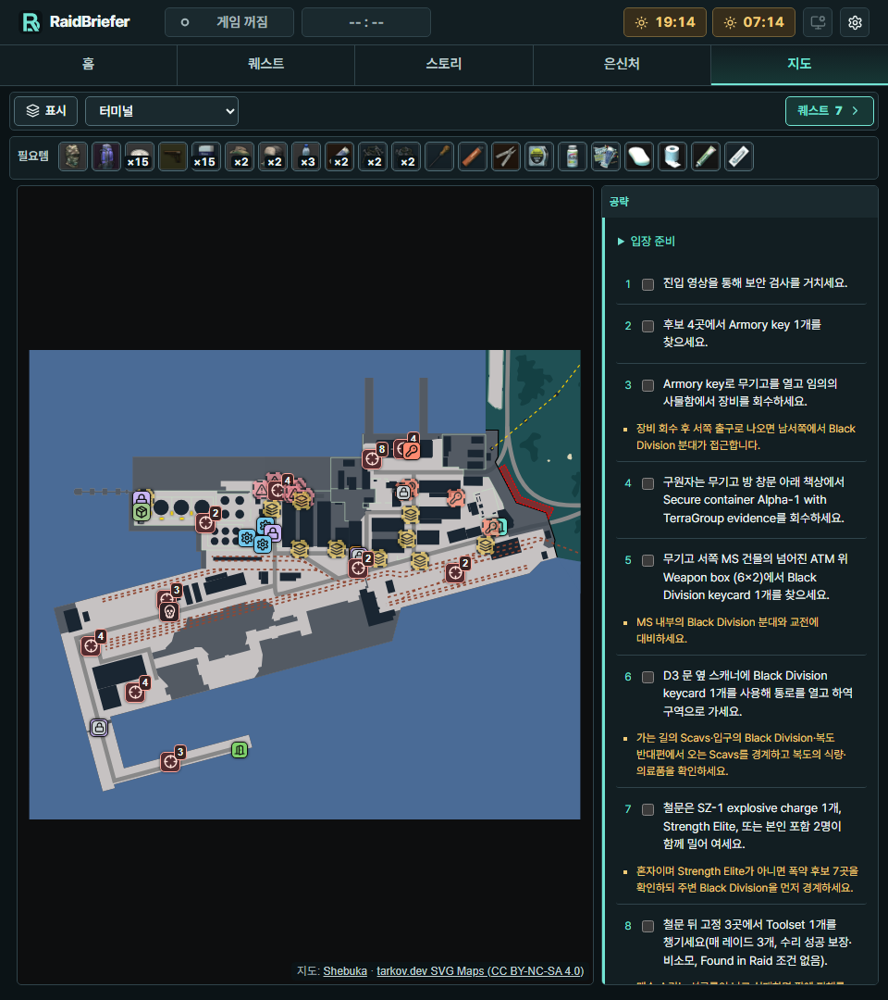
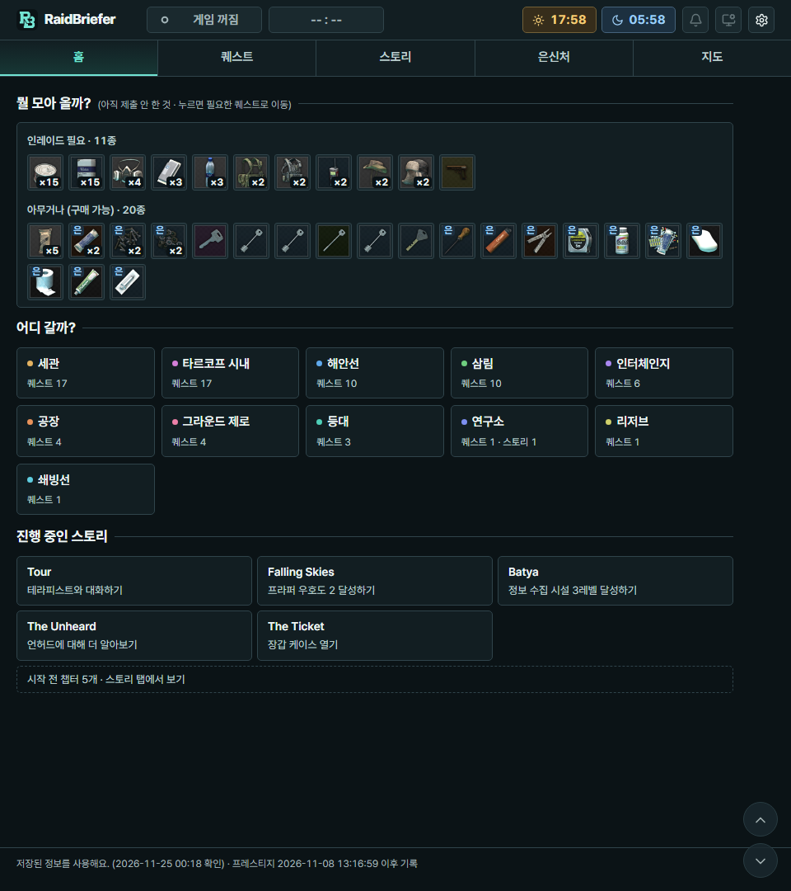
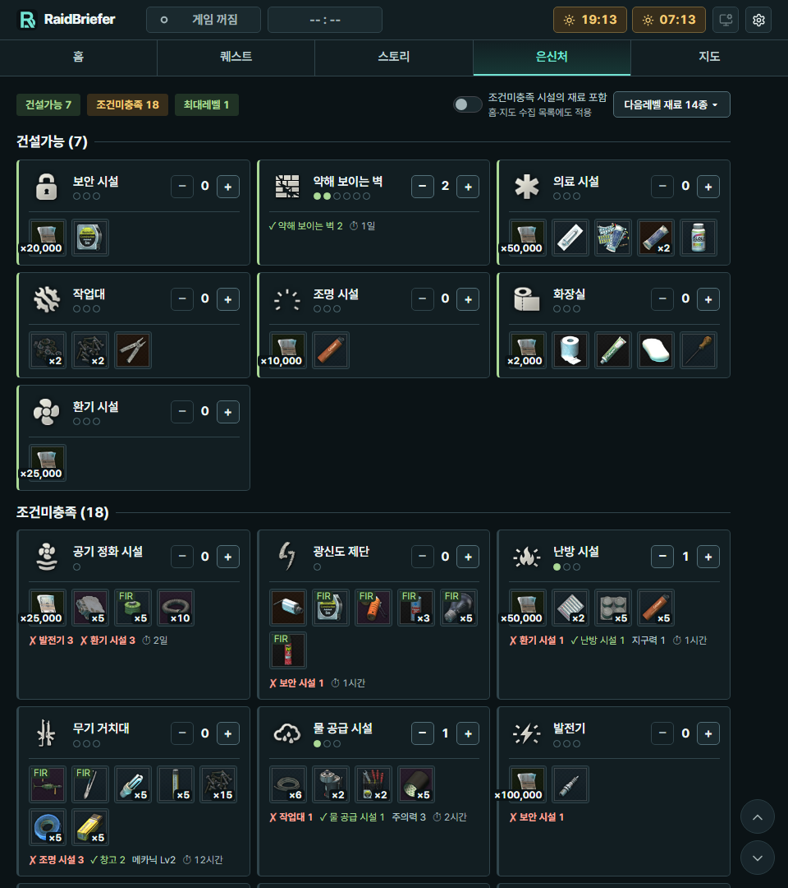
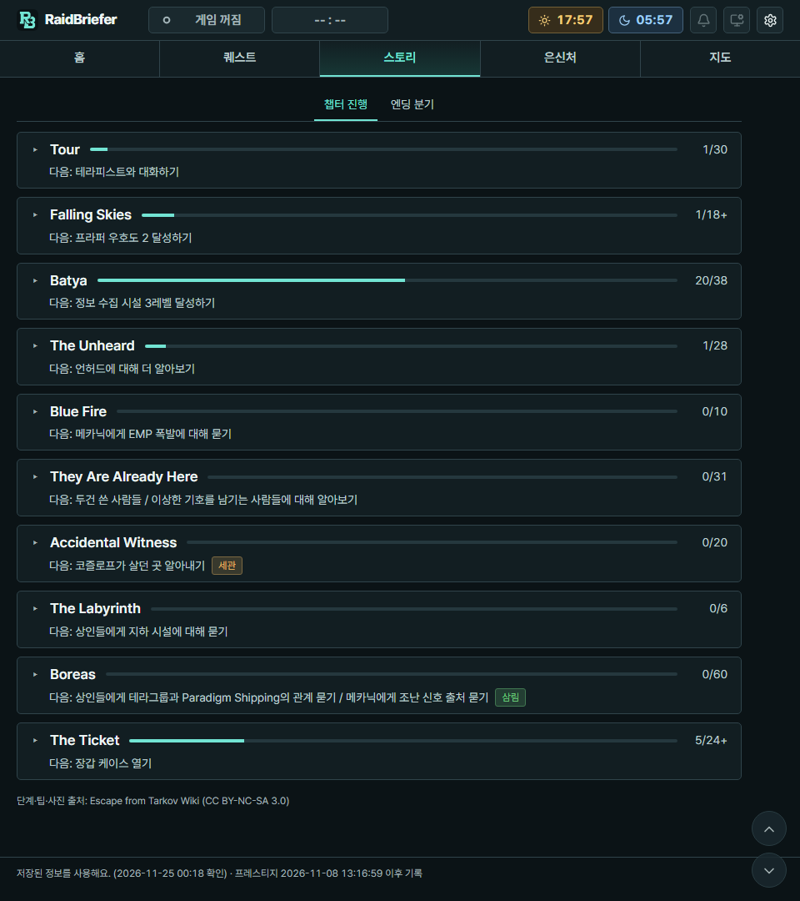

  <a href="README.md">English</a> · <b>한국어</b>

  

  <b>지금 들어간 맵에서 해야 할 퀘스트 목표를, 지도 위에 한 화면으로.</b> 
  Escape from Tarkov <b>PvE 모드</b>용 비공식 도우미 (Windows)

  <a href="https://github.com/Pagliatto/RaidBriefer/releases/latest"><b>⬇ 최신 버전 다운로드 (Windows)</b></a>
  &nbsp;·&nbsp; <a href="#설치">설치 방법</a>
  &nbsp;·&nbsp; <a href="https://github.com/Pagliatto/RaidBriefer/releases">모든 버전</a>

> RaidBriefer는 팬이 만든 **비공식** 프로그램입니다. Battlestate Games(BSG)와 관련이 없으며, BSG가 만들거나 승인한 프로그램이 아닙니다.

---

## 화면

  

| 홈 | 퀘스트 | 은신처 | 스토리 |
|:---:|:---:|:---:|:---:|
|  |  |  |  |

## 무엇을 해 주나요?

손을 거의 대지 않아도 되는 것이 목표예요.

- **맵에 들어가면 자동으로 그 맵의 지도로 바뀌어요.** 레이드가 끝나면 다시 홈으로 돌아와요. 트랜짓도 따라가요.
- **지도 위에 내 퀘스트 목표가 번호로** 표시돼요. 탈출구, 트랜짓, 잠긴 문, 열쇠·비트코인 자리, 층(1층·2층…)도 같이 보여요.
- **퀘스트를 받거나 끝내면 2초 안에** 목록이 바뀌어요. 게임 로그를 보고 자동으로 알아내요.
- **홈 화면**에서 레이드 전에 준비할 것을 한눈에 볼 수 있어요.
  - 뭘 모아 올까? (퀘스트·은신처에 낼 아이템)
  - 어디 갈까? (맵별 할 일 개수)
  - 챙길 것 (열쇠, 무기 등)
- **은신처**: 시설마다 다음 레벨 재료와 조건을 보여 줘요. 모은 재료를 체크하면 수집 목록에서 빠져요.
- **스토리(메인 퀘스트)**: 챕터·단계별로 직접 체크해요. 갈림길(엔딩이 바뀌는 선택)도 안내해요.
- **프레스티지**를 하면 자동으로 알아채고 진행 기록을 새로 시작해요.
- **한국어·영어**를 지원해요. 처음에는 윈도우 언어를 따르고, ⚙ 설정에서 바꿀 수 있어요.
- **새 버전이 나오면 알려 주고**, 버튼 한 번으로 업데이트해요. 기록은 그대로 남아요.

## 안전한가요?

RaidBriefer는 아래 것들만 사용해요.

1. **tarkov.dev 공개 데이터**: 퀘스트, 맵, 아이템, 은신처 정보 (그리고 새 버전 확인을 위해 이 저장소의 최신 버전 번호만 물어봐요)
   - tarkov.dev 에 아직 없는 퀘스트: 깃허브의 공개 [SPT](https://github.com/SP-Tushonka/server-csharp) 데이터 파일에서 퀘스트 이름·맵·이벤트 목록만 받아요 (데이터 파일만 받고, 모드는 쓰지 않아요)
2. 게임이 남기는 **로그 파일**: **읽기만** 해요. 지금 어느 맵인지, 어떤 퀘스트를 받고 끝냈는지 알아내요.
3. 게임이 켜져 있는지: 작업 관리자처럼 **실행 중인 프로그램 이름**(`EscapeFromTarkov.exe`)만 확인해요.

**게임 메모리 읽기, 게임 파일 수정, 모드, 게임 화면 위에 그리기(오버레이)는 하지 않아요.**
그래서 게임과 따로 떨어진 창(서브 모니터 등)으로 봐요.

## 설치

1. **[최신 배포판](https://github.com/Pagliatto/RaidBriefer/releases/latest)** 에서 **`RaidBriefer-vX.Y.Z-windows.zip`** 을 받으세요 (파일 이름에 버전이 들어 있어요).
2. 원하는 곳에 **압축을 푸세요.** (예: `D:\RaidBriefer`)
   - 압축을 풀지 않고 zip 안에서 바로 실행하면 기록이 저장되지 않아요.
3. 폴더 안의 **`RaidBriefer.exe`** 를 더블클릭하면 창이 떠요.
   - 창을 닫으면 프로그램이 완전히 꺼져요.
   - 바탕화면에 바로가기를 만들어 두면 편해요. `RaidBriefer.exe`에서 오른쪽 클릭 → 바로 가기 만들기.

> **"Windows의 PC 보호" 창이 뜨면** **[추가 정보] → [실행]** 을 누르세요.
> 개인이 만든 무료 프로그램이라 유료 코드 서명 인증서가 없어서 뜨는 안내예요. 처음 한 번만 떠요.

**기록 저장 위치**: 압축을 푼 폴더 안의 `user_data` 폴더예요. 폴더째로 옮기면 기록도 같이 옮겨져요.
**업데이트**: 새 버전이 나오면 프로그램 위쪽에 안내가 떠요. **[지금 업데이트]** 를 누르면 알아서 바뀌고 다시 켜져요.
(직접 바꾸려면 새 zip을 기존 폴더에 덮어쓰세요. `user_data` 폴더는 지우지 마세요.)
**지우기**: 폴더를 통째로 지우면 끝이에요. 폴더 밖(레지스트리 등)에는 아무것도 남기지 않아요.

**필요한 것**: Windows 10/11, 인터넷 연결(퀘스트 데이터·지도·글꼴을 받아요), Escape from Tarkov(PvE).
화면은 윈도우에 기본으로 들어 있는 **WebView2**(엣지와 같은 엔진)로 그려요.

소스 코드로 직접 실행하기 (개발용)

1. **Python 3.12 이상** 설치 (설치 첫 화면에서 "Add python.exe to PATH" 체크)
2. 이 저장소를 받고(`<> Code` → `Download ZIP`) `install.bat` 실행
3. `run.bat` 으로 창 실행, `run-in-browser.bat` 으로 브라우저 실행
4. exe 만들기: `.venv\Scripts\python.exe tools\build_exe.py` → `build\RaidBriefer-vX.Y.Z-windows.zip`

## 처음 켰을 때

처음 한 번만 **처음 설정** 화면이 떠요.

1. **게임 설치 위치**: 자동으로 찾아요. 다른 곳에 설치했으면 직접 고를 수 있어요.
2. **진행 중인 퀘스트 확인**: 게임 속 퀘스트 화면과 개수가 같은지 물어봐요.
   - 상인 칸을 누르면 어떤 퀘스트가 들어 있는지 볼 수 있어요.
   - 빠진 게 있으면 직접 추가해요. 게임을 다시 설치해서 로그가 지워졌을 때 필요해요.
3. **은신처 레벨**: 게임 에디션과 지금 시설 레벨을 골라요. 건설 기록은 로그에 남지 않아서 처음 한 번 맞춰야 해요.

이후에는 ⚙ **설정 → 처음 설정 다시 하기**로 언제든 다시 열 수 있어요.

## 화면 크기

모니터 화면의 **절반**(세로로 긴 창)에 맞춰 만들었어요.
FHD(1920×1080) 모니터라면 반쪽 = **960×1080**이에요.

> 💡 RaidBriefer 창을 누른 다음 **Win + ←** 또는 **Win + →** 를 누르면 어느 모니터에서나 정확히 반쪽 크기로 붙어요.

창 크기와 위치는 기억해 둬요. 다음에 켜면 마지막으로 둔 자리에 떠요.

## 알아 두면 좋은 것

- **PvE 전용**이에요. PvP 기록은 보지 않아요.
- **스토리(메인 퀘스트)는 직접 체크**해요. 게임 로그에 스토리 진행 내용이 남지 않아서 그래요.
- **은신처 레벨은 지을 때마다 [+]를 눌러** 맞춰요. 마찬가지로 로그에 건설 기록이 없어요.
- **게임 로그 폴더를 지우면** (게임을 다시 설치하는 등) 예전에 받은 퀘스트를 모를 수 있어요. 이런 경우 홈 위쪽에 안내가 떠요.
- 보스 등장 여부, 레이드 생존·사망 결과는 로그로 알 수 없어서 표시하지 않아요.

## 파일 구성

프로그램만 쓸 거라면 위의 [다운로드](#설치) zip만 받으면 돼요. 아래는 소스 코드를 볼 사람을 위한 설명이에요.

| 파일·폴더 | 용도 |
|---|---|
| `app/` | 프로그램 코드. 서버(파이썬), 화면(HTML·CSS·JS), 게임 로그 읽기, 프로그램 창 |
| `data/` | 프로그램과 같이 나가는 데이터. 스토리 챕터(`story/`), 번역 보정, 직접 적은 퀘스트 |
| `docs/` | README에 쓰는 로고와 화면 사진 |
| `tools/` | 개발 도구. exe 만들기, README 사진 찍기, 스토리 데이터 검사 |
| `.github/ISSUE_TEMPLATE/` | 깃허브 문제 신고·기능 제안 양식 |
| `RaidBriefer.py` | exe로 묶을 때의 시작 파일 |
| `requirements.txt` | 필요한 파이썬 부품 목록 |
| `install.bat` | 소스로 실행할 때 처음 한 번: 파이썬 가상환경과 부품 설치 |
| `run.bat` | 소스로 실행: 프로그램 창 띄우기 |
| `run-in-browser.bat` | 소스로 실행: 창 대신 브라우저로 열기 |
| `LICENSE`, `NOTICE.md` | 라이선스와 출처 |

실행하면 생기는 `user_data/`(내 기록·설정)와 `cache/`(받은 데이터)는 저장소에 올라가지 않아요.

## 문제 신고·기능 제안

이 저장소의 **[Issues](../../issues)** 에 남겨 주세요.
오류가 나면 아래 내용을 같이 적어 주면 원인을 찾기 쉬워요.

- 어떤 화면에서 무엇을 했는지
- 화면 사진
- `user_data/error.log` 파일 내용 (있으면)

⚠ **게임 로그 파일은 올리지 마세요.** 로그 안에 로그인 정보가 들어 있어요.

## 라이선스와 출처

- 소스 코드: **MIT** ([LICENSE](LICENSE))
- 스토리 데이터(`data/story/`)와 tarkov.dev 에 아직 없는 퀘스트(`data/manual_quests.json`): 공식 위키를 번역·요약한 것이라 **CC BY-NC-SA 3.0**
- 지도 그림: tarkov.dev SVG Maps, **CC BY-NC-SA 4.0**
- 데이터: [tarkov.dev](https://tarkov.dev) (The Hideout), 거기에 없는 퀘스트 이름·맵: [SPT](https://github.com/SP-Tushonka/server-csharp) 데이터 파일

스토리 데이터와 지도 그림에 **비상업** 조건이 있어서, RaidBriefer는 **무료·비상업**으로만 배포할 수 있어요.
자세한 출처와 라이선스는 [NOTICE.md](NOTICE.md)에 있어요.

"Escape from Tarkov", 게임 속 이름과 아이템 그림은 Battlestate Games Limited의 자산이에요.
