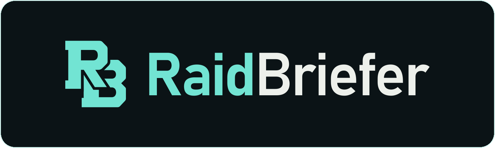
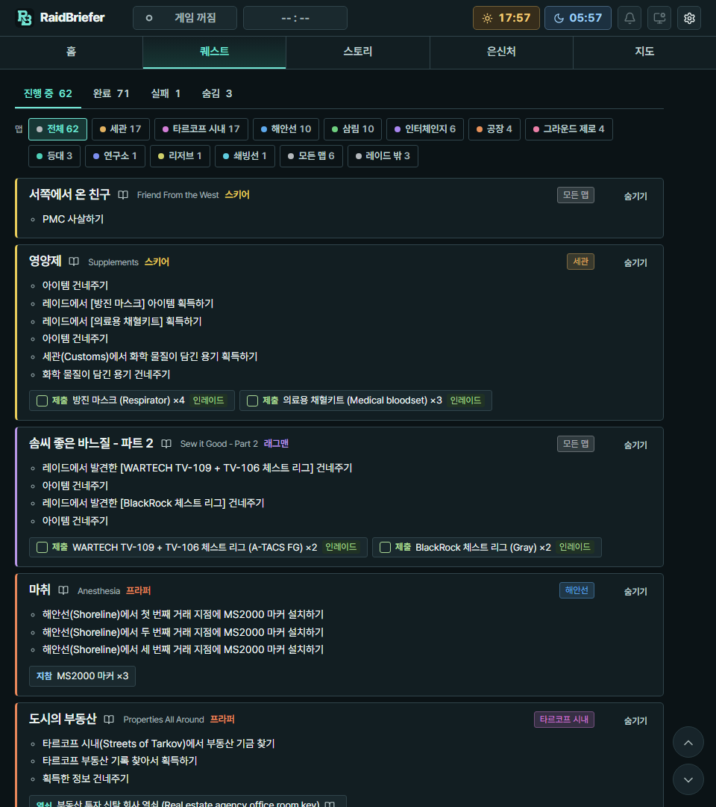

  <a href="README.md">English</a> · <b>한국어</b>

  

  <b>지금 들어간 맵에서 해야 할 퀘스트 목표를, 지도 위에 한 화면으로.</b> 
  Escape from Tarkov <b>PvE 모드</b>용 비공식 도우미 (Windows)

  <a href="https://github.com/Pagliatto/RaidBriefer/releases/latest"><b>⬇ 최신 버전 다운로드 (Windows)</b></a>
  &nbsp;·&nbsp; <a href="#설치">설치 방법</a>
  &nbsp;·&nbsp; <a href="https://github.com/Pagliatto/RaidBriefer/releases">모든 버전</a>
  &nbsp;·&nbsp; <a href="https://discord.gg/8MYr8QABYU">💬 디스코드</a>

> RaidBriefer는 팬이 만든 **비공식** 프로그램입니다. Battlestate Games(BSG)와 관련이 없으며, BSG가 만들거나 승인한 프로그램이 아닙니다.

  

| 홈 | 퀘스트 | 은신처 | 스토리 |
|:---:|:---:|:---:|:---:|
|  |  |  |  |

## 무엇을 해 주나요?

- **맵에 들어가면 자동으로 그 맵의 지도로** 바뀌고, 레이드가 끝나면 홈으로 돌아와요. 손을 거의 대지 않아도 돼요.
- **지도 위에 내 퀘스트 목표가 번호로** 표시돼요. 탈출구·트랜짓·잠긴 문·열쇠 자리·층도 같이 보여요.
- **레이드 전 홈 화면**에서 모을 것, 갈 맵, 챙길 것, 보스 확률을 한눈에 봐요.
- **은신처 재료, 스토리 진행과 엔딩 분기, 터미널 공략**까지 한 프로그램에 있어요.
- **한국어·영어**를 지원하고, 새 버전은 버튼 한 번으로 업데이트해요.

<b>기능 전체 보기</b>

**지도**
- 퀘스트 목표 번호 핀, 탈출구, 트랜짓, 잠긴 문, 열쇠·비트코인 자리, BTR 정류장, 층 전환 (목표를 누르면 그 층으로, 빈 곳을 누르면 1층으로)
- 지금 맵에서 할 목표만 보이는 할 일 목록, 보스·군즈·컬티스트 등장 구역(켜고 끄는 표시)
- 옆의 할 일 목록: 지금 맵에서 할 퀘스트와 스토리 단계. 목표의 눈 아이콘으로 그 레이드 동안만 핀 숨기기
- 잠긴 문·열쇠 자리에 마우스를 올리면 열쇠 정보와 위키 링크
- 내 위치: 게임 스크린샷 키를 누르면 내 위치와 방향을 30초 동안 표시 (파일 이름만 읽어요)
- 남은 시간 경고: 10분·5분·2분 남으면 지도 둘레가 붉게 빛나요 (끌 수 있어요)
- 터미널: 입장 준비와 진행 순서, 열쇠·배전반·공구·폭약 자리, Black Division 등장 위치와 인원, 보스 위치

**홈 · 퀘스트**
- 홈: 뭘 모아 올까, 어디 갈까(맵별 할 일 개수), 고른 맵에서 퀘스트마다 챙길 것(다 챙기기·장비 맞추기·바로 출발), 보스 등장 확률
- 퀘스트: 받은 퀘스트와 완료를 게임 로그에서 자동으로 반영, 맵 태그로 골라 보기, 이름 옆 위키 링크
- 프레스티지를 하면 알아채고 진행 기록을 새로 시작해요

**은신처 · 스토리**
- 은신처: 시설마다 다음 레벨 재료와 조건, 지을 수 있게 되면 표시. 모은 재료는 체크
- 스토리(메인 퀘스트): 단계별 체크, 챕터의 남은 장소를 지도에 표시
- 엔딩 분기: The Ticket 흐름도에서 내 위치와 다음 갈림길 보기

**그 밖에**
- 게임 밝기: 레이드 중에만 게임을 밝게 (테두리 없는 창 모드)
- 스크린샷 정리: 쌓인 게임 스크린샷을 설정에서 직접 누를 때만 휴지통으로
- 🔔 알림함: 문제가 생기면 코드와 함께 알려 주고, 신고 버튼에 코드가 자동으로 들어가요
- 자동 업데이트: 기록은 그대로 두고 프로그램만 바뀌어요. '바뀐 점'도 보여 줘요

**알아 두면 좋은 것**
- **PvE 전용**이에요.
- 스토리 진행과 은신처 건설은 게임 로그에 남지 않아서 **직접 체크**해요. 처음 켤 때 한 번 맞춰요.
- 모니터 **절반**(FHD 기준 960×1080)에 맞춰 만들었어요. 창을 누르고 **Win + ←/→** 를 누르면 딱 맞게 붙어요.
- 보스 확률과 터미널의 무작위 등장 위치는 참고용이에요.

## 안전한가요?

RaidBriefer는 아래 것들만 사용해요.

- **공개 데이터**: [tarkov.dev](https://tarkov.dev)의 퀘스트·맵·아이템·은신처 정보와, 거기에 없는 내용을 채우는 공식 위키·[SPT](https://github.com/SP-Tushonka/server-csharp) 데이터 파일. 새 버전 확인은 이 저장소의 버전 번호만 물어봐요
- 게임이 남기는 **로그 파일**(읽기만)과, 게임이 찍은 **스크린샷의 파일 이름**(위치 좌표)
- 게임이 켜져 있는지 보려고 **실행 중인 프로그램 이름**(`EscapeFromTarkov.exe`)만 확인

**게임 메모리 읽기, 게임 파일 수정, 모드, 게임 화면 위에 그리기(오버레이), 키 대신 누르기는 하지 않아요.** 그래서 게임과 따로 떨어진 창(서브 모니터 등)으로 봐요.

## 설치

1. **[최신 배포판](https://github.com/Pagliatto/RaidBriefer/releases/latest)** 에서 **`RaidBriefer-vX.Y.Z-windows.zip`** 을 받으세요.
2. 원하는 곳에 **압축을 푸세요.** zip 안에서 바로 실행하면 기록이 저장되지 않아요.
3. 폴더 안의 **`RaidBriefer.exe`** 를 실행하세요.

> **"Windows의 PC 보호" 창이 뜨면** **[추가 정보] → [실행]** 을 누르세요. 개인이 만든 무료 프로그램이라 유료 코드 서명 인증서가 없어서 뜨는 안내예요.

- **필요한 것**: Windows 10/11, 인터넷 연결, Escape from Tarkov(PvE)
- **기록**은 폴더 안의 `user_data` 에 저장돼요. **지울 때**는 폴더를 통째로 지우면 끝이에요.
- **소스로 실행**: Python 3.12 이상에서 `install.bat` → `run.bat`

## 문제 신고·질문

- 💬 **[디스코드](https://discord.gg/8MYr8QABYU)**: 궁금한 것, 가벼운 문제 &nbsp;·&nbsp; 🐞 **[GitHub Issues](../../issues)**: 버그 신고, 기능 제안
- 오류가 났다면 프로그램 오른쪽 위 🔔 → **[파일 위치 열기]** 로 나오는 **`report.txt`** 를 같이 올려 주세요. 시각·버전·오류 코드·맵 이름만 들어 있어서 그대로 올려도 안전해요.
- ⚠ **게임 로그 파일(게임 폴더의 `Logs`)은 올리지 마세요.** 로그인 정보가 들어 있어요.

## 라이선스와 출처

- 소스 코드는 **MIT** ([LICENSE](LICENSE))예요.
- 함께 들어 있는 스토리·공략·보정 데이터(공식 위키 기반)와 지도 그림(tarkov.dev)에는 **비상업** 조건(CC BY-NC-SA)이 있어서, RaidBriefer는 **무료·비상업**으로만 배포할 수 있어요.
- 자세한 출처와 라이선스는 [NOTICE.md](NOTICE.md)에 있어요.

"Escape from Tarkov", 게임 속 이름과 아이템 그림은 Battlestate Games Limited의 자산이에요.
