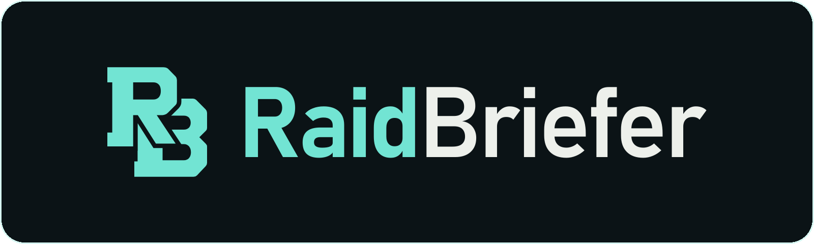
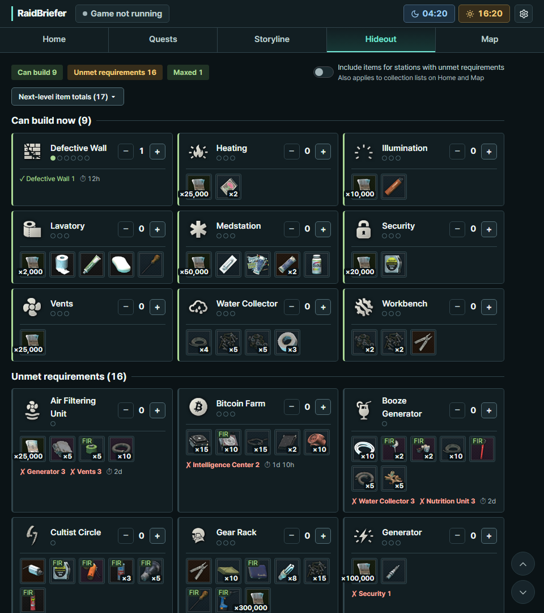
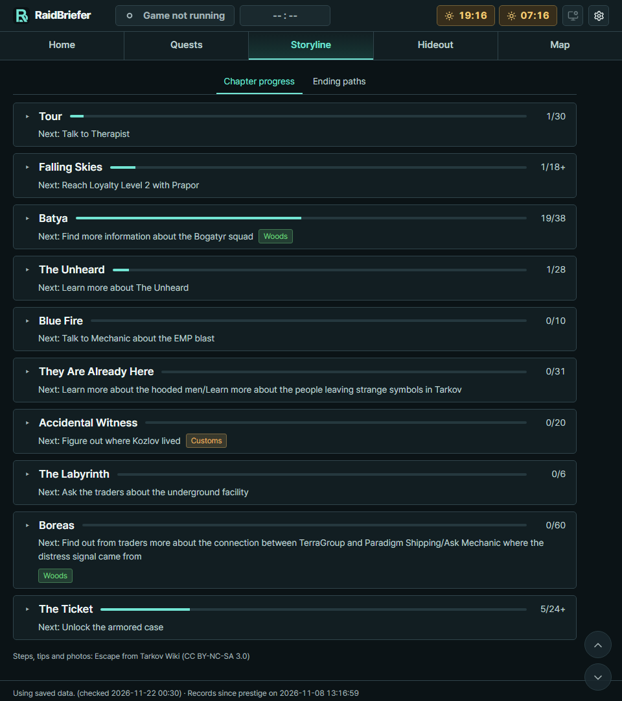

  <b>English</b> · <a href="README.ko.md">한국어</a>

  

  <b>Your quest objectives for the map you're on — on one screen, on the map.</b> 
  An unofficial companion for the <b>PvE mode</b> of Escape from Tarkov (Windows)

  <a href="https://github.com/Pagliatto/RaidBriefer/releases/latest"><b>⬇ Download the latest version (Windows)</b></a>
  &nbsp;·&nbsp; <a href="#install">How to install</a>
  &nbsp;·&nbsp; <a href="https://github.com/Pagliatto/RaidBriefer/releases">All releases</a>
  &nbsp;·&nbsp; <a href="https://discord.gg/8MYr8QABYU">💬 Discord</a>

> RaidBriefer is an **unofficial** fan-made tool. It is not affiliated with or endorsed by Battlestate Games (BSG).

  

| Home | Quests | Hideout | Storyline |
|:---:|:---:|:---:|:---:|
|  |  |  |  |

## What it does

- **When you load into a map, it switches to that map automatically**, and goes back to Home after the raid. You barely have to touch it.
- **Your quest objectives are numbered on the map**, together with extracts, transits, locked doors, key spawns and floors.
- **Home, before a raid**: what to collect, where to go, what to bring, and boss chances at a glance.
- **Hideout items, storyline progress with ending paths, and a Terminal guide** — all in one program.
- **English and Korean**, with one-click updates.

<b>See all features</b>

**Map**
- Numbered quest objective pins, extracts, transits, locked doors, key and Bitcoin spawns, BTR stops, floor switching
- To-do list that shows only the current map's objectives; boss, Goon and cultist spawn zones (optional layers)
- To-do list beside the map: quests and story steps for the current map. The eye icon hides an objective's pins for that raid only
- Hover locked doors and key spawns for key details and wiki links
- My position: press the in-game screenshot key to see where you are and which way you're facing for 30 seconds (only the file name is read)
- Low-time warning: the edge of the map glows red at 10, 5 and 2 minutes left (can be turned off)
- Terminal: entry preparation and steps, key, electrical panel, toolset and explosive spots, Black Division spawns with head counts, the boss location

**Home · Quests**
- Home: what to collect, where to go (tasks per map), what to bring (keys, weapons), boss spawn chances for the selected map
- Quests: accepted and completed quests are picked up from the game log automatically; filter by map tag; wiki link beside each name
- Prestige is detected and progress starts fresh

**Hideout · Storyline**
- Hideout: items and requirements for each station's next level, with a badge once it can be built. Check off what you've collected
- Storyline (main quests): check off steps; the remaining places of a chapter are shown on the map
- Ending paths: The Ticket flowchart shows where you are and the next fork

**More**
- Game brightness: brighten the game during raids only (borderless window mode)
- Clean up screenshots: piled-up game screenshots go to the Recycle Bin only when you press the button in Settings
- 🔔 Alerts menu: problems are shown with a code, and the report buttons fill in the codes for you
- Updates: your records are kept and only the program changes. A What's new popup shows what changed

**Good to know**
- **PvE only.**
- Storyline progress and hideout construction are not in the game logs, so you **check them off yourself**. You set them once on first start.
- Made for **half** a monitor (960×1080 on FHD). Click the window and press **Win + ←/→** to snap it into place.
- Boss chances and Terminal's random spawn spots are for reference only.

## Is it safe?

RaidBriefer only uses:

- **Public data**: quests, maps, items and hideout from [tarkov.dev](https://tarkov.dev), plus the official wiki and [SPT](https://github.com/SP-Tushonka/server-csharp) data files for what is missing there. Update checks only ask this repository for its latest version number
- The game's **log files** (read only) and the **file names of screenshots** the game takes (the position in the name)
- The **process name** (`EscapeFromTarkov.exe`), only to see whether the game is running

**It never reads game memory, modifies game files, uses mods, draws over the game (overlay), or sends key presses to the game.** That's why it runs in its own window (for example on a second monitor).

## Install

1. Open the **[latest release](https://github.com/Pagliatto/RaidBriefer/releases/latest)** and download **`RaidBriefer-vX.Y.Z-windows.zip`**.
2. **Extract it** anywhere you like. Don't run it from inside the zip, or your records won't be saved.
3. Run **`RaidBriefer.exe`** in the folder.

> **If "Windows protected your PC" appears**, click **More info → Run anyway**. It's a free program made by an individual without a paid code-signing certificate.

- **Requirements**: Windows 10/11, an internet connection, Escape from Tarkov (PvE)
- **Records** are saved in the `user_data` folder inside. **To uninstall**, just delete the whole folder.
- **Run from source**: Python 3.12+, then `install.bat` → `run.bat`

## Bugs and questions

- 💬 **[Discord](https://discord.gg/8MYr8QABYU)**: questions, small problems &nbsp;·&nbsp; 🐞 **[GitHub Issues](../../issues)**: bug reports, feature requests
- If something went wrong, please attach **`report.txt`**: 🔔 at the top right → **[Show file location]**. It only holds times, versions, error codes and map names, so it is safe to upload as is.
- ⚠ **Don't upload game log files (the `Logs` folder in the game folder).** They contain your login information.

## License and credits

- Source code: **MIT** ([LICENSE](LICENSE)).
- The bundled storyline, guide and correction data (based on the official wiki) and the map images (tarkov.dev) are **non-commercial** (CC BY-NC-SA), so RaidBriefer may only be distributed **free and non-commercially**.
- Full credits and licenses are in [NOTICE.md](NOTICE.md).

"Escape from Tarkov", in-game names and item images are the property of Battlestate Games Limited.
