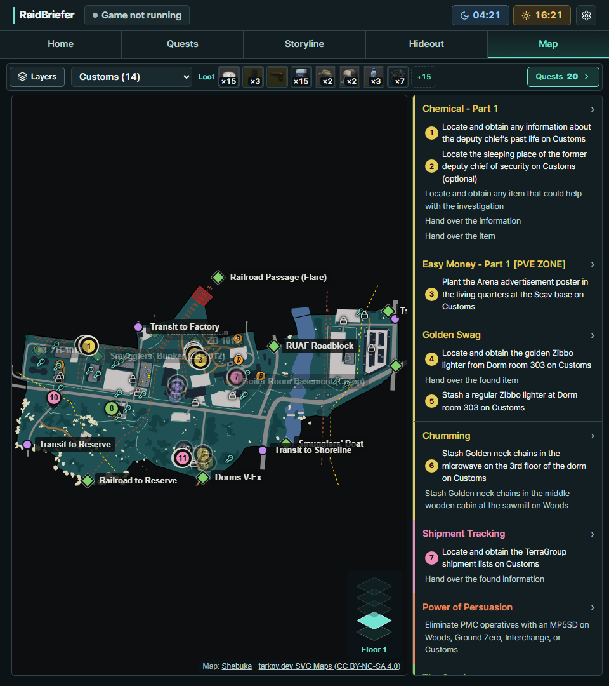
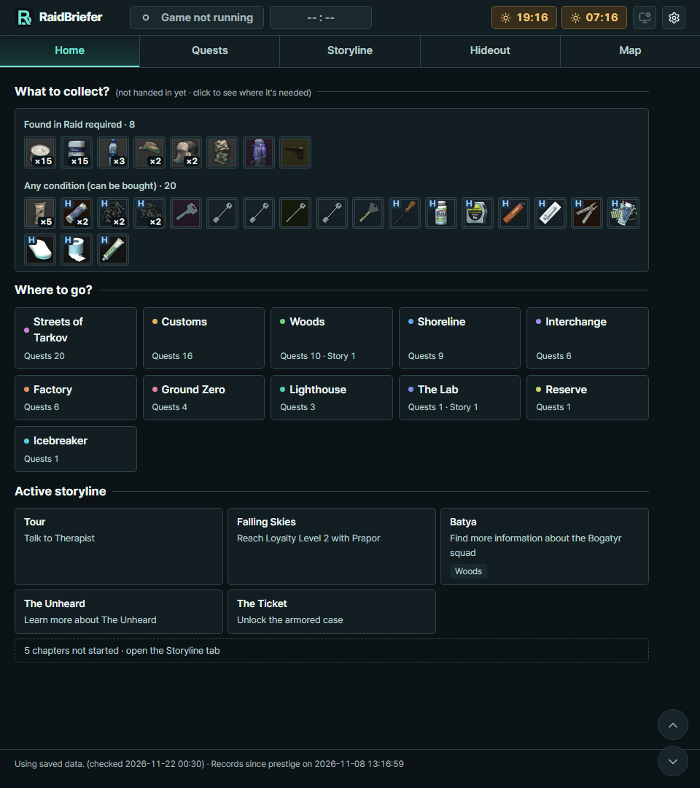
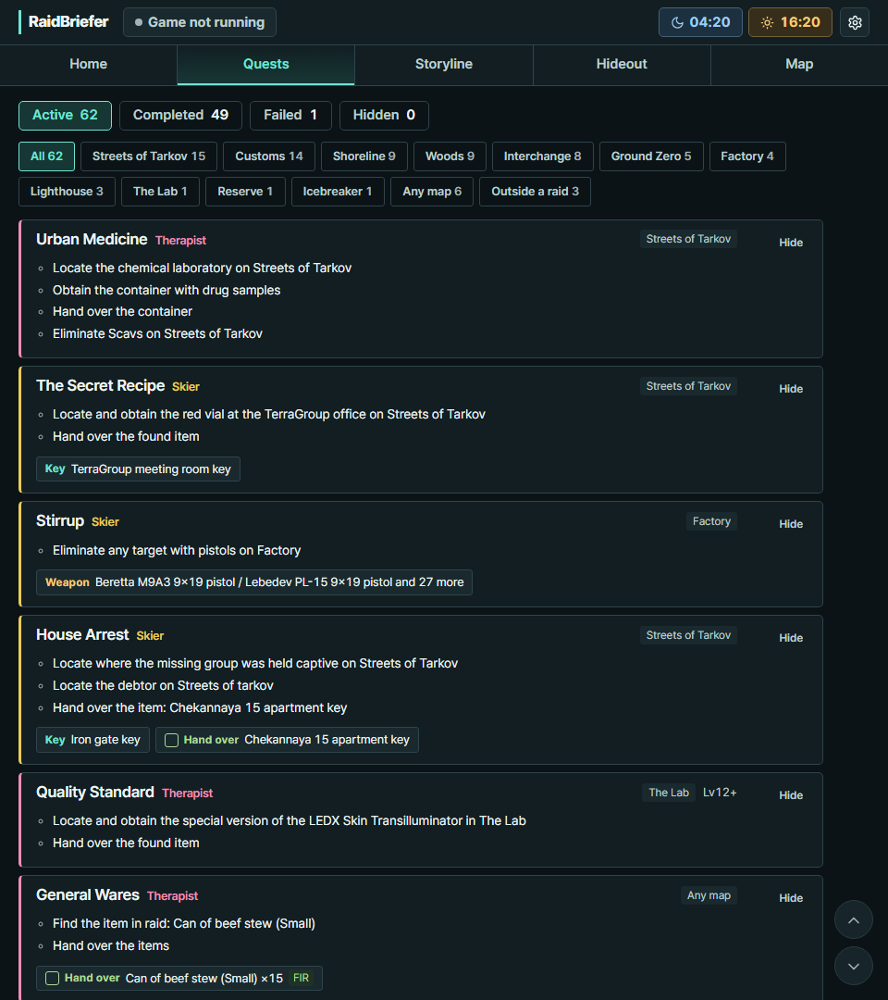

  <b>English</b> · <a href="README.ko.md">한국어</a>

  

  <b>Your quest objectives for the map you're on — on one screen, on the map.</b> 
  An unofficial companion for the <b>PvE mode</b> of Escape from Tarkov (Windows)

  <a href="https://github.com/Pagliatto/RaidBriefer/releases/latest"><b>⬇ Download the latest version (Windows)</b></a>
  &nbsp;·&nbsp; <a href="#install">How to install</a>
  &nbsp;·&nbsp; <a href="https://github.com/Pagliatto/RaidBriefer/releases">All releases</a>

> RaidBriefer is an **unofficial** fan-made tool. It is not affiliated with or endorsed by Battlestate Games (BSG).

---

## Screenshots

  

| Home | Quests | Hideout | Storyline |
|:---:|:---:|:---:|:---:|
|  |  |  |  |

## What it does

The goal is that you barely have to touch it.

- **When you load into a map, it switches to that map automatically.** After the raid it goes back to Home. It also tracks Transits.
- **Your quest objectives are numbered on the map**, together with extracts, transits, locked doors, key and Bitcoin spawns, and floors.
- **New and completed quests show up within 2 seconds.** It reads the game logs to find out.
- **Home** shows what to prepare before a raid:
  - What to collect (items for quests and the hideout)
  - Where to go (tasks per map)
  - What to bring (keys, weapons, gear)
- **Hideout**: items and requirements for each station's next level. Check off collected items to remove them from the collection list.
- **Storyline (main quests)**: mark chapters and steps as complete yourself. Decisions that change the ending are explained.
- **Prestige** is detected automatically and progress starts fresh.
- **English and Korean.** It follows your Windows language at first; change it in ⚙ Settings.
- **Tells you when a new version is out** and updates with one click. Your records are kept.

## Is it safe?

RaidBriefer only uses:

1. **Public data from tarkov.dev**: quests, maps, items, hideout (plus the latest version number of this repository, to check for updates)
   - For quests not on tarkov.dev yet: quest names, maps and the event list from the public [SPT](https://github.com/SP-Tushonka/server-csharp) data files on GitHub (only the data files are downloaded; no mod is used)
2. The game's **log files** — **read only**. That's how it knows which map you're on and which quests you accepted or completed.
3. Whether the game is running — it only checks the **process name** (`EscapeFromTarkov.exe`), like Task Manager.

**It never reads game memory, modifies game files, uses mods, or draws over the game (overlay).**
That's why it runs in its own window (for example on a second monitor).

## Install

1. Open the **[latest release](https://github.com/Pagliatto/RaidBriefer/releases/latest)** and download **`RaidBriefer-vX.Y.Z-windows.zip`** (the file name shows the version).
2. **Extract it** anywhere you like (e.g. `D:\RaidBriefer`).
   - Don't run it from inside the zip, or your records won't be saved.
3. Double-click **`RaidBriefer.exe`** in the folder.
   - Closing the window closes the program completely.
   - Tip: right-click `RaidBriefer.exe` → Create shortcut, and put it on your desktop.

> **If "Windows protected your PC" appears**, click **More info → Run anyway**.
> It's a free program made by an individual without a paid code-signing certificate. You'll only see this once.

**Where records are saved**: the `user_data` folder inside the extracted folder. Move the whole folder and your records come with it.
**Updates**: when a new version is out, a notice appears at the top. Click **Update now** and it updates and restarts by itself.
(To update manually, extract the new zip over the old folder. Don't delete `user_data`.)
**Uninstall**: just delete the folder. Nothing is left outside it (no registry entries).

**Requirements**: Windows 10/11, an internet connection (for quest data, maps and fonts), Escape from Tarkov (PvE).
The screens are drawn with **WebView2** (the same engine as Microsoft Edge), which is built into Windows.

Run from source (for developers)

1. Install **Python 3.12+** (check "Add python.exe to PATH" on the first installer screen)
2. Download this repository (`<> Code` → `Download ZIP`) and run `install.bat`
3. Run `run.bat` for the program window, or `run-in-browser.bat` to open it in a browser
4. Build the exe: `.venv\Scripts\python.exe tools\build_exe.py` → `build\RaidBriefer-windows.zip`

## First start

The **first-time setup** opens on your first launch.

1. **Game folder**: found automatically. If you installed it elsewhere, you can pick it.
2. **Active quests**: checks that the count matches the quest screen in the game.
   - Click a trader to see which quests are listed.
   - Add any missing quests yourself — needed if the logs were deleted (e.g. after reinstalling the game).
3. **Hideout levels**: choose your game edition and current station levels. Building isn't recorded in the logs, so you set this once.

You can open it again any time in ⚙ **Settings → Run first-time setup again**.

## Window size

It's designed for **half of your monitor** (a tall window).
On a Full HD (1920×1080) monitor, half is **960×1080**.

> 💡 Click the RaidBriefer window and press **Win + ←** or **Win + →** to snap it to exactly half of any monitor.

The window remembers its size and position and opens there next time.

## Good to know

- **PvE only.** PvP records are not read.
- **Storyline progress is marked manually.** The game logs don't record storyline progress.
- **Press [+] on a hideout station when you build it.** Building isn't in the logs either.
- **If the game log folder is deleted** (e.g. when reinstalling the game), the app may miss quests you accepted earlier. A notice appears at the top of Home when that happens.
- Boss spawns and raid survival/death aren't in the logs, so they aren't shown.

## Files

If you only want to use the program, the [download](#install) zip is all you need. This is for people reading the source.

| File / folder | Purpose |
|---|---|
| `app/` | Program code: server (Python), screens (HTML/CSS/JS), log reading, program window, translations (`app/i18n/`) |
| `data/` | Data shipped with the program: storyline chapters (`story/`), translation fixes, manually added quests |
| `docs/` | Logo and screenshots for the README |
| `tools/` | Developer tools: build the exe, take README screenshots, check storyline and translation data |
| `.github/ISSUE_TEMPLATE/` | GitHub forms for bug reports and feature requests |
| `RaidBriefer.py` | Entry point when building the exe |
| `requirements.txt` | Python packages needed |
| `install.bat` | Run from source, first time: create the Python environment and install packages |
| `run.bat` | Run from source: open the program window |
| `run-in-browser.bat` | Run from source: open in a browser instead of the window |
| `LICENSE`, `NOTICE.md` | License and credits |

`user_data/` (your records and settings) and `cache/` (downloaded data), created when you run it, are never uploaded to the repository.

## Bugs and feature requests

Please use this repository's **[Issues](../../issues)**.
For errors, these help a lot:

- Which screen, and what you did
- A screenshot
- The contents of `user_data/error.log` (if it exists)

⚠ **Don't upload game log files.** They contain your login information.

## License and credits

- Source code: **MIT** ([LICENSE](LICENSE))
- Storyline data (`data/story/`) and quests not on tarkov.dev yet (`data/manual_quests.json`): summarized and translated from the official wiki — **CC BY-NC-SA 3.0**
- Map images: tarkov.dev SVG Maps — **CC BY-NC-SA 4.0**
- Data: [tarkov.dev](https://tarkov.dev) (The Hideout); quest names/maps missing there: [SPT](https://github.com/SP-Tushonka/server-csharp) data files

Because the storyline data and map images are **non-commercial**, RaidBriefer may only be distributed **free and non-commercially**.
Full credits and licenses are in [NOTICE.md](NOTICE.md).

"Escape from Tarkov", in-game names and item images are the property of Battlestate Games Limited.
